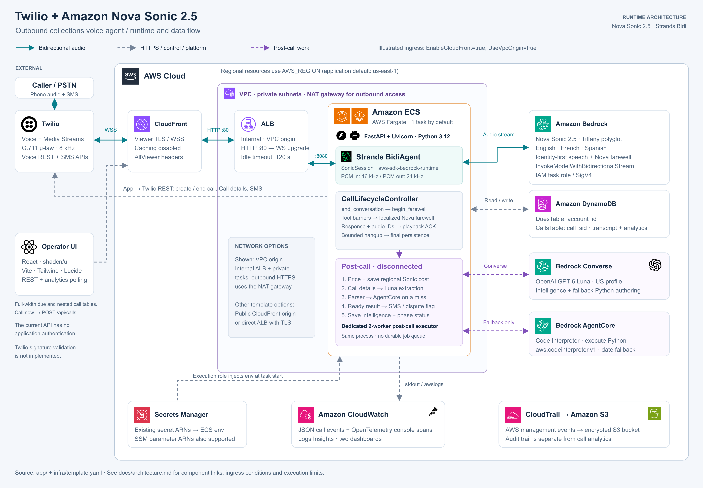
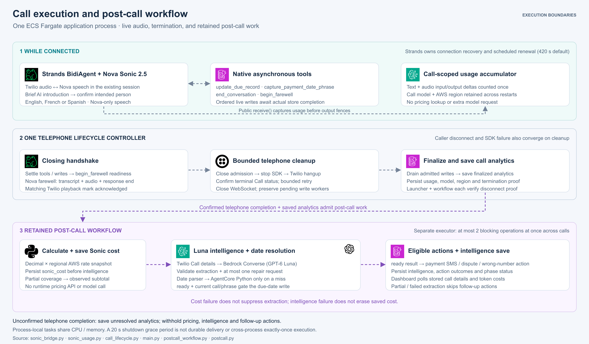
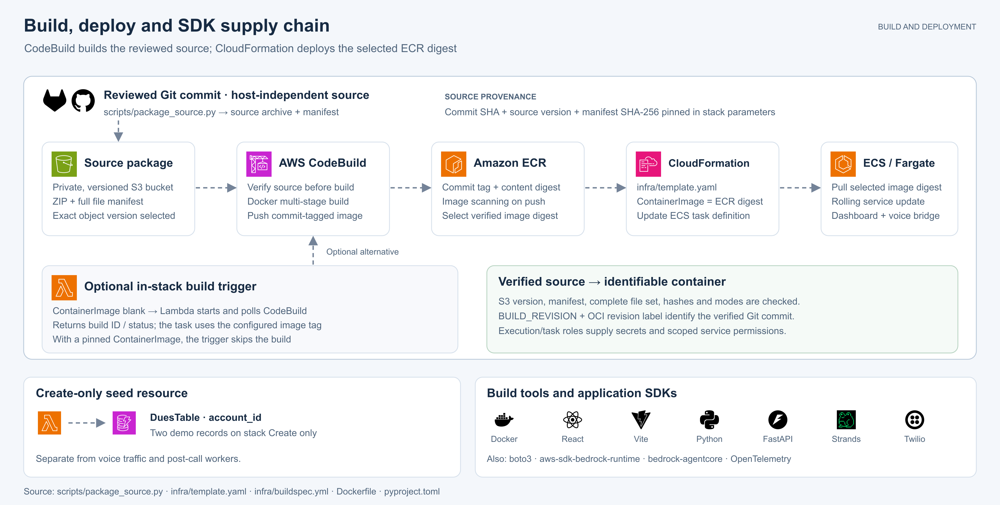

# Architecture: Twilio and Amazon Nova Sonic 2.5

This guide describes the application components, execution boundaries and
infrastructure defined by the repository. Model IDs, region, task size and
ingress modes are configurable.

[Open the runtime SVG](diagrams/architecture.svg). The illustrated configuration
uses `EnableCloudFront=true` and `UseVpcOrigin=true`: CloudFront reaches an
internal ALB through a VPC origin, with Fargate tasks in private subnets and NAT
for outbound traffic. Other supported template modes are described below.
AWS service icons identify AWS services; software logos identify libraries and
external products. See [diagram provenance](diagrams/README.md).

## Runtime and data flow

The application is an outbound Accounts Receivable voice agent. A single
FastAPI service serves the dashboard and APIs, bridges Twilio audio to Amazon
Bedrock, persists call records, and runs post-call analysis.

| Component | Implemented responsibility | Source |
| --- | --- | --- |
| Operator dashboard | React 18 UI with Radix/shadcn components, Tailwind and Lucide. The dashboard shows transcript text, tools and compact TTFT/TTFA timelines on a shared response-duration axis. Light/Dark selection is saved in browser storage. Vite builds static files served by FastAPI; the browser calls same-origin `/api/*`. | [Frontend dependencies](../frontend/package.json), [Vite configuration](../frontend/vite.config.ts), [dashboard hooks](../frontend/src/hooks.ts) |
| HTTP and WebSocket application | Python 3.12, FastAPI and Uvicorn; `/`, `/static/*`, `/healthz`, `/api/config`, dues/call APIs and `/media`. | [Application](../app/main.py), [container](../Dockerfile) |
| Telephony | Twilio Programmable Voice, bidirectional Media Streams, outbound-call/hangup REST operations, post-call Call-resource lookup, and SMS. | [Twilio client](../app/twilio_client.py) |
| Conversation engine | Strands `BidiAgent` / `BedrockNovaSonicModel` and `aws-sdk-bedrock-runtime` connect to Amazon Bedrock model `amazon.nova-2-5-sonic`. A brief AI introduction asks for the intended person; the prompt requires explicit identity confirmation before discussing the account. Tiffany's native polyglot voice follows caller switches between English, French and Spanish in the same session. | [Bridge](../app/sonic_bridge.py), [agent prompt](../app/collections_agent.py), [language policy](../app/languages.py), [Python dependencies](../pyproject.toml) |
| Audio conversion | Stateful G.711 μ-law 8 kHz → PCM16 16 kHz inbound; PCM16 24 kHz → μ-law 8 kHz outbound. Twilio messages carry base64 audio. | [Audio adapters](../app/audio.py) |
| Telephone lifecycle | One `CallLifecycleController` supervises the SDK run and Twilio reader, coordinates tool settlement and farewell playback, and owns bounded termination and final persistence. | [Lifecycle controller](../app/call_lifecycle.py) |
| In-call tools | `update_due_record`, `capture_payment_date_phrase`, `end_conversation`, and `begin_farewell`. Date capture writes the phrase; date resolution runs later. The two closing tools coordinate a Nova-generated farewell. | [Agent tools and prompt](../app/collections_agent.py) |
| Account and call persistence | DynamoDB `DuesTable` keyed by `account_id`, and `CallsTable` keyed by `call_sid`. Both use on-demand billing, encryption and point-in-time recovery. | [Store](../app/store.py), [CloudFormation](../infra/template.yaml) |
| Post-call workflow | Confirmed telephone completion admits a fixed workflow: calculate and save Sonic cost, then run intelligence. A dedicated executor permits at most two blocking post-call operations concurrently, separately from the live I/O executor. | [Workflow](../app/postcall_workflow.py), [launch and shutdown](../app/main.py) |
| Sonic usage and cost | Observed Nova text/audio input/output deltas are accumulated once across connections. A deterministic worker applies the call region's reviewed AWS on-demand pricing snapshot after disconnection and saves `sonic_cost` independently. | [Usage accounting](../app/sonic_usage.py), [pricing](../app/sonic_pricing.py), [metrics](../app/metrics.py) |
| Post-call intelligence | A worker uses boto3 Bedrock Converse with OpenAI GPT-6 Luna (`us.openai.gpt-6-luna`) to extract disposition, structured data and a next action, with result validation and a bounded repair request. | [Post-call pipeline](../app/postcall.py) |
| Date resolution | A deterministic Python parser handles supported phrases first. On a miss, the text model authors Python which the `bedrock-agentcore` SDK executes in Amazon Bedrock AgentCore Code Interpreter (`aws.codeinterpreter.v1`). | [Hybrid resolver](../app/date_resolver.py), [interpreter client](../app/code_interpreter.py) |

### Call lifecycle

1. The operator loads `/` and selects a due record. `POST /api/calls` looks up
   the account, validates required configuration, then uses the Twilio Python
   SDK to create the outbound call. The current route always targets
   `TWILIO_VERIFIED_CALLER_ID`; disabling SMS trial mode does not change that
   call destination.
2. Inline TwiML `<Connect><Stream>` tells Twilio to open
   `wss://<PUBLIC_BASE_URL>/media` and pass `accountId` as a stream parameter.
   There is no separate TwiML webhook or Amazon Connect service in this flow.
3. On Twilio's `start` message, FastAPI loads the account context, creates a
   per-call `CallLifecycleController`, `CallToolRuntime` and `SonicSession`,
   builds the prompt/tools, and starts one supervised Strands run. A kickoff
   instruction makes Ava introduce herself briefly and ask whether she is
   speaking to the intended person. The prompt waits for explicit confirmation
   before mentioning the balance, due date or payment options; another person,
   silence, or a simple hello does not establish identity. This is a
   conversational check, not external identity authentication. Strands owns model-connection
   recovery; the telephone controller owns the call across those connections.
4. Incoming frames pass through the stateful audio adapter into the agent's
   asyncio input queue. The Bedrock bidirectional stream returns speech,
   transcript, usage and other events. Output audio is transcoded and sent
   back to Twilio; interruption handling sends Twilio `clear` messages to
   discard queued playback.
5. The model can write the account outcome or capture a payment-date phrase
   through tools. These writes use the configured store, including DynamoDB
   network calls in the AWS configuration. Tool coroutines await worker-thread
   I/O; Nova Sonic and Strands keep the audio stream responsive while tool
   results are pending. Writes for a call retain ordering and completion/error
   metadata instead of reporting success before persistence.
6. `end_conversation` waits for outstanding business tools and actual store
   writes, then returns a fresh attempt ID. The model must call `begin_farewell`
   with that ID. This second tool waits until prior tool groups have completed,
   reached the SDK history, and were successfully submitted to the model.
   Only its successfully submitted readiness result permits the farewell.
7. Nova Sonic speaks the configured `CLOSING_GREETING` in the existing
   conversation. The controller correlates newly received audio and the closing
   transcript with the response identity and connection generation. After
   response/audio completion, it sends a unique Twilio `mark` after the delivered
   media and requires the matching stream's acknowledgement. Caller interruption,
   a restart, or further output invalidates closing evidence. A timed-out
   farewell attempt resumes the conversation; a bounded recovery instruction
   can ask Nova to explain that the call remains connected.
8. A successful playback handshake atomically closes tool/output admission.
   The controller stops the SDK, requests Twilio termination, closes the local
   WebSocket, and drains retained writes before final persistence. Unexpected
   SDK exit, caller disconnect and transport failure converge on that same
   cleanup owner. Provider response completion alone does not terminate the
   telephone call or finalize its metrics.
9. Saving analytics launches post-call processing only when Twilio terminal
   status is confirmed. Both the launcher and workflow require that proof.
   The browser polls the call detail for Sonic cost and intelligence;
   it does not receive live transcripts directly from the audio WebSocket.

The controller progresses through `ACTIVE`, `SETTLING_TOOLS`,
`PREPARING_FAREWELL`, `WAITING_FOR_PLAYBACK`, `COMMITTING`, and `CLOSED`.
An invalidated attempt returns to `ACTIVE` with a fresh attempt required for
another farewell. Application observers record evidence synchronously; the
controller's owned tasks perform the waits and cleanup. The public model
`send()` observation distinguishes actual result submission from
`ToolResultMessageEvent`, which only confirms SDK history recording.

All closing and recovery speech comes from Nova Sonic. The opening is in
English, and the prompt limits subsequent replies to English, French or Spanish
according to the caller. Recognition itself remains native Nova behavior.
`end_conversation` binds one of these languages and its required farewell phrase
to the attempt; `begin_farewell` returns that exact greeting. Duplicate requests
cannot change an active attempt's language. The English default is “Thank you
for your time. Goodbye.” French uses “Merci pour votre temps. Au revoir.” and
Spanish uses “Gracias por su tiempo. Adiós.” The controller verifies the selected
phrase with audio, response and playback evidence before accepting completion.
`termination.closing_language` records the selected farewell language, not an
inferred language for every utterance in the call.

| Wait | Default bound | Timeout meaning |
| --- | --- | --- |
| Business-tool settlement | 20 seconds | Abandon the farewell attempt and keep listening. A running store write remains tracked. |
| Farewell preparation and generation | 15 seconds | Abandon the attempt; no playback or telephone completion is inferred. |
| Twilio playback acknowledgement | 30 seconds | Abandon the attempt; absence of acknowledgement is not proof of playback. |
| SDK cleanup and WebSocket close | 5 seconds per stage | Record unconfirmed cleanup and retain work still running. |
| Twilio terminal request | 10 seconds per HTTP wait; at most update → fetch → one update retry | An uncertain request remains unknown unless a returned Call resource confirms terminal status. |
| Final write drain/persistence in the handler | 20 seconds | Keep the finalization task alive after the handler's bounded wait. |

[`hangup_call_async`](../app/twilio_client.py) confirms only an observed
`completed`, `canceled`, `failed`, `busy`, or `no-answer` status. It records
`confirmed_terminal`, `request_failed`, or `unknown`, the last observed status,
update-attempt count, and whether an HTTP worker remains pending. Its bounded
async wait does not cancel an HTTP request already running in a thread. Each
request owns a Twilio client with a socket timeout and SDK retries disabled;
thread results are retained and observed safely.

A local `CLOSED` state therefore means local cleanup has progressed, not that
Twilio necessarily confirmed telephone completion. Unconfirmed termination is
persisted explicitly with `intelligence_status=withheld_unconfirmed_termination`;
post-call analysis and its SMS side effects are withheld. Confirmed termination
permits `_launch_postcall` after actual write settlement and the analytics save.
DynamoDB changes do not trigger analysis: there is no DynamoDB Stream consumer.

### Post-call processing and its execution boundary

[Open the execution-flow SVG](diagrams/call-processing.svg). The live audio
path, the telephone completion barrier, and post-call workers share one
application process but have distinct admission and execution rules:

| Phase | Owner and execution | Persistent result / next gate |
| --- | --- | --- |
| Live conversation | Strands streams audio and schedules native tool coroutines. `CallToolRuntime` retains ordered account/date-phrase writes on the default executor via `asyncio.to_thread`. The public model `receive()` observer adds usage deltas to the call-scoped accumulator before output can be discarded. | Tools return actual write outcomes. Token counters require no pricing lookup or additional model request. |
| Telephone cleanup | `CallLifecycleController` closes admission, performs bounded SDK shutdown and Twilio termination, closes the WebSocket, and retains the final write-drain/persistence task. | Save call analytics with usage, model, region and explicit telephone-completion evidence. An unresolved telephone outcome cannot admit post-call work. |
| Cost calculation | `_launch_postcall` and `run_postcall_workflow` each check confirmed telephone completion. A retained workflow dispatches deterministic costing through the dedicated post-call executor. | Save `sonic_cost` first; a cost failure does not prevent the intelligence phase. |
| Intelligence and actions | The same workflow runs Twilio Call lookup, Luna extraction, date resolution and eligible follow-up actions through the post-call executor. | Save intelligence separately, then record workflow phase outcomes and timestamps. A failed intelligence phase does not erase saved cost. |

`run_postcall_workflow` is launched with `asyncio.create_task` and held in
`_POSTCALL_TASKS` until completion. The entry point rejects a record without
`termination.telephone_completion_confirmed=true` before running pricing,
inference or storage work. It runs inside the same Fargate application process.
The sequence is:

1. Calculate Sonic cost from the finalized call's accumulated provider tokens,
   model ID and AWS region. Apply four disjoint rates: text input, audio input,
   text output and audio output. Save `sonic_cost` separately from intelligence.
   This calculation uses Python `Decimal` and the reviewed AWS Price List
   snapshot; it performs no pricing API or model call at runtime. Unsupported
   models, regions or usage categories remain unpriced. Incomplete coverage is
   explicitly partial, with an observed subtotal rather than a full-call total.
2. Fetch the Twilio Call resource for transport/billing facts, with an explicit
   unavailable result on failure. The code marks advanced Voice Insights QoS
   unavailable; it does not query a paid advanced-insights API.
3. Send the transcript to OpenAI GPT-6 Luna through Bedrock Converse. Validate
   the result's sections and field types, distinguish facts that were not
   discussed from incomplete output, and allow one repair request.
4. Resolve dates using the deterministic parser, then the model-authored
   AgentCore fallback where needed. Store resolution provenance with the
   analysis. Already supported phrases do not require an interpreter session.
5. Only when validated extraction status is exactly `ready`, apply eligible
   follow-up actions. A promise to pay sets `collection_paused=True` and attempts
   a Twilio SMS; a dispute sets `escalated=True` and emits a structured log;
   a wrong number emits a flagging event. Partial or failed extraction does
   not run these actions. Writing a resolved promised date to the due record
   additionally requires that the stored phrase still belongs to this call,
   so a later call's capture is not overwritten. These are data flags and
   logs; the repository does not implement a human work queue or an automatic
   collection scheduler. The call-creation route does not enforce the paused
   flag.
6. Update `CallsTable` with intelligence, model provenance, field availability,
   action results and analysis status. A persistence error is logged on a
   best-effort basis.

The SMS link uses `PAYMENT_LINK_BASE_URL`, whose template value is
`https://pay.example.com/`; this repository does not implement payment
processing. Trial-mode SMS targets the verified number; the full-account
branch can use the account's phone number.

The workflow follows the [Strands Workflow pattern](https://strandsagents.com/docs/user-guide/sdk/multi-agent/multi-agent-patterns/):
application code defines the dependencies. Costing is deterministic arithmetic;
Luna supplies the intelligence specialization. No Graph/Swarm routing or
additional model is needed to decide this fixed sequence, and neither worker
is exposed as a live Bidi tool. Each phase has its own status and timestamps
in `postcall_workflow`. Failed costing does not suppress extraction; failed
extraction does not erase the independently saved cost.

The asynchronous workflow awaits `run_postcall_blocking`, which dispatches
blocking work to a dedicated `ThreadPoolExecutor(max_workers=2)`. Costing is
one worker operation; `extract_and_apply` then offloads its synchronous
intelligence pipeline to the same executor. The two-worker limit is shared
across calls. Boto3, Twilio and Code Interpreter I/O execute outside the audio
loop and do not consume the default executor's live-call I/O workers. Account
updates and date-phrase capture remain live tools:
they save caller-confirmed data and return real persistence success or failure.
Date calculation, classification, pricing and follow-up actions run after
confirmed disconnection.

Payment dates use a call-scoped captured phrase and the call timestamp in
`PAYMENT_TIMEZONE` (default UTC). A supported relative phrase is resolved
deterministically before any AgentCore fallback; the same result feeds the due
and Intelligence fields. Provenance records the phrase, reference date,
timezone, source and resolver. A conflicting model-produced date cannot
silently override the caller's captured phrase.

**Execution limits:** post-call workers share the Fargate process's CPU and
memory; the executor bounds running workers, not the number of waiting jobs.
They are not durable jobs. Shutdown allows a 20-second grace period for retained
tasks; a timeout does not assert that an SDK operation was rolled back.
Abrupt process loss can interrupt analysis. There is no persistent job lease,
retry queue or cross-process exactly-once guarantee. The per-call controller
and shared persistence task prevent duplicate launch within the owning call.
Thread offloading does not reduce model-service or network latency
by itself. Nova's optional `NOVA_ENDPOINTING_SENSITIVITY` can adjust turn-taking;
blank preserves its default, while HIGH may respond sooner at the cost of
interrupting deliberate pauses.

## Ingress and network options

The template accepts an existing VPC and public subnets. Its defaults are
`EnableCloudFront=false` and `UseVpcOrigin=false`; CloudFront is an optional
front door.

| Template settings | Viewer and origin path | Application placement |
| --- | --- | --- |
| Both flags false (template default) | Public ALB. HTTP listener on port 80; optional HTTPS listener when `CertificateArn` is supplied. A trusted TLS certificate and matching public hostname are needed for a usable Twilio WSS endpoint. | Public subnets; Fargate public IP enabled. Application port 8080 admits the ALB security group. |
| `EnableCloudFront=true`, `UseVpcOrigin=false` | CloudFront managed `*.cloudfront.net` viewer TLS → public ALB over HTTP:80. ALB ingress accepts the configured CloudFront origin-facing managed prefix list. | Public subnets; Fargate public IP enabled. |
| Both flags true | CloudFront viewer TLS → VPC-origin service-managed ENI → internal IPv4 ALB over HTTP:80. | Private subnets; Fargate public IP disabled; one NAT gateway supplies outbound access to Twilio and AWS endpoints. |

CloudFront uses the managed `CachingDisabled` and `AllViewer` policies. The
latter forwards the WebSocket handshake headers. The current AWS
[WebSocket guide](https://docs.aws.amazon.com/AmazonCloudFront/latest/DeveloperGuide/distribution-working-with.websockets.html)
allows WebSockets with CloudFront distributions and documents HTTP/1.1 for
WebSocket connections. The current
[VPC-origin guide](https://docs.aws.amazon.com/AmazonCloudFront/latest/DeveloperGuide/private-content-vpc-origins.html)
documents the VPC-origin networking requirements. The diagram represents the
private-origin configuration supported by this template.

The CloudFront-to-ALB hop is configured as HTTP, including the public-origin
option. Prefix-list filtering identifies CloudFront source networks; it does
not authenticate this application's operator or restrict traffic to a single
customer distribution. In VPC-origin mode this template still uses the
origin-facing prefix list for ALB ingress, rather than a rule referencing only
the service-managed VPC-origin security group.

The VPC-origin branch creates private subnet resources with the CIDRs defined
in the template, even when existing `PrivateSubnetIds` are provided; supplied
IDs are selected for the application instead. The VPC must accommodate those
resources without address conflicts. That branch also needs
`NatGatewaySubnetId`. The template does not create the base VPC, public
subnets, Internet gateway, or VPC endpoints.

## Identity, secrets and storage

The four Twilio values are **external prerequisites** supplied as Secrets
Manager or Systems Manager Parameter Store ARNs. The template does not create
those secret values. The ECS execution role is allowed to read those specific
ARNs and inject their values into container environment variables at task
startup. Application code reads the environment; it does not call Secrets
Manager on every request. Replacing a stored secret therefore requires new
tasks to receive the changed value.

The separate ECS task role authorizes Bedrock streaming and text-model
invocation, the AgentCore interpreter session operations, reads/writes on the
two DynamoDB tables, and app log writes. The interpreter permissions include
the AWS-managed interpreter ARN, in-account interpreter ARNs, and session
ARNs. AWS SDKs obtain task credentials through the runtime credential chain;
there are no static AWS access keys required by this architecture.

The existing API handlers do not implement dashboard-user authentication or
authorization, and `/media` accepts the WebSocket without validating a
Twilio request signature. Consequently, the ingress symbols in the diagram
represent network routing rather than a verified user or Twilio identity
boundary. Twilio's
[Media Streams documentation](https://www.twilio.com/docs/voice/media-streams)
describes `X-Twilio-Signature` validation requirements.

With both `DUES_TABLE` and `CALLS_TABLE` environment variables set, the store
uses DynamoDB. Otherwise it falls back to a seeded, process-local in-memory
store suitable for development/tests. The application stores account data,
transcripts, call events, derived metrics and post-call intelligence; it does
not configure a raw-audio archive. There is no automatic table TTL in the
CloudFormation template.

## Observability

[CallMetrics](../app/metrics.py) collects session/turn events, transcripts,
usage, derived latency values, and the controller’s termination evidence.
The provider's `BidiUsageEvent` contains incremental counts. The model adapter
records usage before output admission can discard queued/interrupted audio,
and the downstream output handler does not count that event again. The
call-scoped accumulator retains counts across native connection renewals.
It validates text/audio totals; it does not estimate tokens from transcript
length or audio duration. This constant-size accounting does no pricing or
network I/O on the streaming path. Known incomplete SDK cleanup marks the
saved usage coverage partial because a retained provider task may still hold
unreceived usage.
Lifecycle events distinguish aborted farewell attempts, playback confirmation,
cleanup timeouts and confirmed or unresolved telephone termination. JSON logs go to stdout and the ECS `awslogs`
driver forwards them to `/ecs/<stack>/app` in CloudWatch Logs. The default
retention is 30 days.

[Strands telemetry setup](../app/telemetry.py) runs once before the agent starts.
It defaults to the OpenTelemetry console exporter, so SDK spans also reach
CloudWatch through stdout. Optional OTLP export requires an independently
provided collector endpoint; no collector, X-Ray service integration, or
AgentCore Runtime is provisioned here.

The template creates aggregate and per-call CloudWatch dashboards, largely
using Logs Insights over the app's JSON events. The API's
[dashboard link builder](../app/dashboard.py) opens the named per-call
dashboard; the operator enters `call_sid` in its `CALL_SID` field. The URL does
not automatically populate the call filter. Twilio transport-delay estimates
are derived metrics, not measured RTT or provider-reported QoS.

A separate multi-region CloudTrail records management events to an encrypted,
versioned S3 bucket with public access blocked and log-file validation enabled.
It is not an audio/transcript store, and this template does not enable Bedrock
model invocation logging or an exhaustive inference-usage data-event trail.

## Build architecture

[Open the deployment SVG](diagrams/deployment.svg). The figure shows the
source package, infrastructure provisioning, image build and SDKs.
The image is built from a package of one exact committed Git revision.
The repository host is independent of the build: the packager reads the local
Git commit, and CodeBuild's configured source is S3. The repository-host logos
identify hosting options, not direct CodeBuild source connectors.

1. The [source packager](../scripts/package_source.py) reads the selected Git
   commit, creates a ZIP, and adds `source-manifest.json` with the commit SHA,
   file SHA-256 hashes and executable flags. Links and submodules are rejected.
   It reports the manifest and archive checksums without adding working-tree
   files. The archive is uploaded as `source/<full-commit-SHA>.zip`.
2. [Artifact CloudFormation](../infra/artifacts.yaml) provisions a private,
   encrypted, versioned, retained S3 bucket for source packages and stack
   templates. The application stack independently pins the full commit SHA,
   source key, S3 object version and manifest SHA-256.
3. [ImageBuildProject](../infra/template.yaml) uses that S3 source and version.
   Its inline bootstrap validates the pinned manifest and verifier script
   before invoking [source verification](../infra/verify_source.sh). Verification
   checks the actual CodeBuild S3 source version, complete file set, hashes and
   executable flags before running any repository build script. S3
   `CODEBUILD_SOURCE_VERSION` is the object version; the separate expected Git
   revision supplies build provenance after those checks.
4. The shared [build script](../infra/build_image.sh) runs the multi-stage
   [Dockerfile](../Dockerfile): Node.js builds React/Vite, then Python 3.12 installs
   and serves the app as a non-root user. CodeBuild pushes the commit-tagged
   image to ECR. `BUILD_REVISION` and the OCI revision label identify the verified
   source commit. The operator selects the verified ECR digest for deployment.
5. CloudFormation sets `ContainerImage` to that digest and ECS performs a
   rolling update. Keeping the previous digest pinned permits source/build
   configuration changes before selecting the new image. Leaving
   `ContainerImage` blank enables the optional `ImageBuildTrigger` Lambda
   custom resource to build and wait inside CloudFormation. That optional path
   reports the build ID and status, and the task uses the configured image tag;
   it does not resolve or pin an image digest. A separate Lambda seeds two
   example dues only on stack Create; it does not participate in calls or
   post-call processing.

The task configuration is 0.5 vCPU / 1 GiB with `DesiredCount=1` by default.
No ECS autoscaling policy is defined. These settings are not a measured
concurrent-call capacity. `ImageTag` defaults to `latest`; use commit tags and
immutable image digests for reviewed releases. `SourceVersion` has no mutable
branch default and requires the full reviewed commit SHA.
