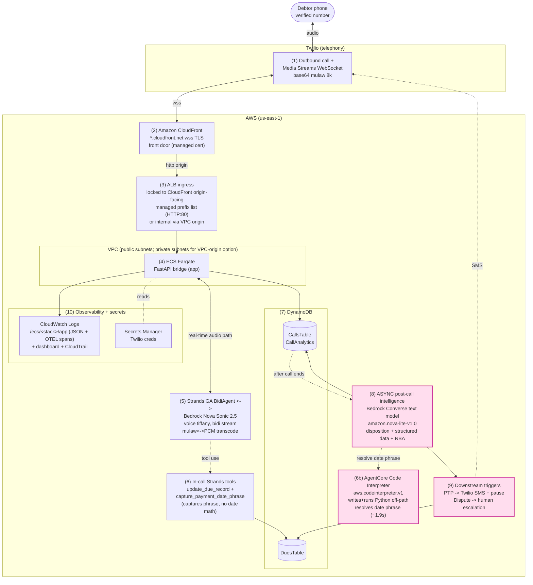

# AWS Architecture

AR Collections Nova Sonic 2.5 Agent: an AI-initiated outbound collections voice
agent. Twilio carries the audio, Amazon Bedrock Nova Sonic 2.5 is the
speech-to-speech brain (via the GA `strands.bidi` API), DynamoDB persists
state, and the intelligence (disposition + structured data + next-best-action)
is extracted **asynchronously after the call ends** so it never adds to call
latency.

The public entry point is the CloudFront distribution domain, published as the
`CloudFrontDomainName` stack output (`https://<cloudfront-domain>/`).

The numbered labels (1..10) in the diagram map one-to-one to the phase
explanations below it.

## Phases

1. **Twilio outbound call.** Twilio places the AI-initiated outbound call (trial
   account, so only the verified number is reachable) and opens a Media Streams
   WebSocket carrying base64 G.711 mulaw, 8 kHz, mono.
2. **CloudFront TLS front door.** Amazon CloudFront (`*.cloudfront.net`,
   free managed cert) terminates viewer TLS at the edge so Twilio connects over
   `wss://`. The public domain is the `CloudFrontDomainName` stack output
   (`https://<cloudfront-domain>/`).
3. **ALB ingress.** By default (Option 1) the Application Load Balancer accepts
   only CloudFront origin-facing edge IPs via the AWS-managed
   `com.amazonaws.global.cloudfront.origin-facing` prefix list on HTTP:80
   (region-specific id; resolve with `aws ec2 describe-managed-prefix-lists`), so
   the raw ALB DNS is not directly reachable. The optional CloudFront **VPC
   origin** (Option 2, `UseVpcOrigin=true`) goes further: the ALB is internal in
   private subnets with no public IP (see the security note below).
4. **ECS Fargate bridge.** The FastAPI app runs as a Fargate task (in public
   subnets by default, or private subnets with NAT egress under the VPC-origin
   option), bridging the Twilio WebSocket to Nova.
5. **Strands GA BidiAgent + Nova Sonic 2.5.** Bidirectional streaming to Bedrock
   Nova Sonic 2.5 (voice `tiffany`) via the GA `strands.bidi`
   `BedrockNovaSonicModel` does STT + reasoning + TTS; the app transcodes mulaw
   8k <-> PCM on the real-time audio path.
6. **In-call Strands tools.** `update_due_record` writes the outcome;
   `capture_payment_date_phrase` only RECORDS the debtor's raw date phrase
   (e.g. "next month 1st Monday") on the due record and returns immediately, so
   it adds no latency to the turn.
6b. **AgentCore Code Interpreter (off-path).** `app/code_interpreter.py` wraps
   the AWS Bedrock AgentCore Code Interpreter (`aws.codeinterpreter.v1`). After
   the call, a Bedrock TEXT model (the same `EXTRACTION_MODEL_ID`) is prompted
   with only the arguments (today's date + the captured phrase) to **author** a
   Python program on the fly; that model-written program is then `executeCode`-run
   in the sandbox to resolve a concrete `YYYY-MM-DD`. The ~1.9s session is why
   this runs only post-call,
   never on the real-time turn. The task role carries a dedicated
   least-privilege `agentcore-code-interpreter` grant
   (`bedrock-agentcore:StartCodeInterpreterSession` /
   `InvokeCodeInterpreter` / `StopCodeInterpreterSession`, scoped to
   `code-interpreter/*`) for exactly this SDK path - no
   Create/Delete/List, because the managed `aws.codeinterpreter.v1` default
   needs none.
7. **DynamoDB persistence.** `DuesTable` holds due/account records and
   `CallsTable` holds the CallAnalytics record (numeric fields stored as
   `Decimal` via float->Decimal conversion).
8. **ASYNC post-call intelligence.** After the call ends and off the audio path,
   the Bedrock Converse text model `amazon.nova-lite-v1:0` extracts the Call
   Disposition, Structured Conversation Data, and the Next-Best-Action from the
   transcript.
9. **Downstream triggers.** Driven by the disposition: Promise to Pay (PTP)
   sends a Twilio SMS payment link and pauses automated collection; Dispute
   Raised escalates the account to a human specialist (flag/event).
10. **Observability + secrets.** CloudWatch Logs (`/ecs/<stack>/app`, carrying
    both the per-call JSON lines and the GA Strands OTEL spans), the
    `<stack>-observability` dashboard, and a CloudTrail trail record activity;
    Twilio credentials live in Secrets Manager.

## Origin network isolation: prefix-list allow-list vs. CloudFront VPC origin

Two ingress postures are available when CloudFront fronts the ALB; exactly one
is active per deploy (they are mutually exclusive in `infra/template.yaml`).

- **Option 1 (`UseVpcOrigin=false`) — prefix-list allow-list.** The
  public-facing ALB keeps a public IP, and its security group admits only the
  AWS-managed CloudFront origin-facing prefix list on HTTP:80. This is an
  **IP-based** control: the origin is still on the public internet, just
  filtered to CloudFront's published source ranges. Those ranges change over
  time, and the allow-list is only as current as the managed prefix list.

- **Option 2 (activated, `UseVpcOrigin=true`) — CloudFront VPC origin.** The ALB
  is provisioned **internal** in **private subnets with no public IP**, the Fargate
  tasks run private (`AssignPublicIp=DISABLED`, egress via a NAT gateway to
  reach Twilio/Bedrock), and CloudFront reaches the origin through a
  service-managed `AWS::CloudFront::VpcOrigin` ENI
  (`AWS::CloudFront::VpcOrigin` → the distribution's `Origins[].VpcOriginConfig`).

**Why the VPC origin improves security.** It provides **network-level
isolation** rather than source-IP filtering: the origin has **no public IP and
no public endpoint at all**, and is reachable **only** through the CloudFront
distribution's VPC origin ENI. There is nothing on the public internet to scan,
reach, or spoof-source-IP against — compared with the prefix-list option, which
leaves a public ALB that merely allow-lists a set of CloudFront IP ranges that
drift over time.

**Activated posture / operational note.** VPC origin is the **activated** origin
posture on the reference stack (`UseVpcOrigin=true`). The internal ALB and the
CloudFront VPC origin are **IPv4** (`IpAddressType=ipv4`), which is sufficient
for the private CloudFront-VPC-origin → ALB path. The private subnets and their
NAT egress are provisioned by the template itself (IaC) when `UseVpcOrigin=true`
and `PrivateSubnetIds` is left blank, so no manual subnet creation is needed;
the subnets in use are surfaced by the `ProvisionedPrivateSubnetIds` stack
output. Switching an existing stack from a public ALB to an internal one
**replaces** the load balancer (new DNS/ARN — not a zero-downtime in-place
change), but the CloudFront **domain is unchanged** across that replacement. The
first VPC origin in an account also triggers a one-time auto-provisioning of the
`AWSServiceRoleForCloudFrontVPCOrigins` service-linked role.

## Telemetry: GA Strands OTEL spans vs. CallMetrics

The GA `strands.bidi` agent loop auto-emits OpenTelemetry (OTEL) spans once
`StrandsTelemetry` is configured **before** the agent runs. The app configures
it exactly once at startup (`app/telemetry.py`, guarded so a failure never
crashes startup or the real-time audio path) and defaults to the **console
exporter**: spans are written to stdout, which the ECS `awslogs` driver already
ships to CloudWatch Logs. That means session token usage and per-response TTFT
land in CloudWatch with **no new IAM and no new infrastructure**. Set
`OTEL_EXPORTER=otlp` (with `OTEL_EXPORTER_OTLP_ENDPOINT`) to send to a collector
instead, or `OTEL_ENABLED=false` to turn telemetry off. These are non-secret
knobs surfaced via `/api/config`.

Two sources of truth, each owning what it measures best:

| Signal | Authoritative source | Notes |
| --- | --- | --- |
| Session token usage (`gen_ai.usage.*`) | **OTEL** `bidi_session` span | Reported by the model; emitted automatically. |
| Per-response TTFT (`gen_ai.server.time_to_first_audio`) | **OTEL** `bidi_response` span | Native time-to-first-audio, measured inside the agent loop. |
| Tool-call / connection-restart / barge-in | **OTEL** spans + span events | Emitted automatically by the GA loop. |
| Per-utterance `turn_count`, conversational turns | **CallMetrics** | Derived from transcript-role alternation; OTEL spans do not model per-utterance chat turns. |
| Nova speaking time (`nova_total_ms`) | **CallMetrics** | Summed from outbound audio-frame durations. |
| Disposition + structured post-call data | **CallMetrics** / post-call extraction | Business signals, not in OTEL. |
| Twilio transport latency (`twilio_latency_ms`) | **CallMetrics** | Derived from Twilio media timestamps. |

The user-facing dashboard continues to read from `CallMetrics` unchanged; OTEL
now provides TTFT and session token usage **authoritatively** alongside it, for
cross-checking in CloudWatch, without altering the audio path.

## IAM (least privilege)

The ECS **task role** holds four separate, independently-scoped policy blocks so
each permission tracks exactly one capability (see `infra/template.yaml`):

- `bedrock-nova-sonic-bidi` - `bedrock:InvokeModelWithBidirectionalStream` /
  `InvokeModel` on just the Nova Sonic foundation-model ARN (phase 5).
- `bedrock-text-extraction` - `bedrock:InvokeModel` on just the configured
  `ExtractionModelId` text-model ARN (phase 8); the grant and the
  `EXTRACTION_MODEL_ID` env var derive from the same parameter so they cannot
  drift.
- `agentcore-code-interpreter` - the three AgentCore Code Interpreter session
  actions the off-path date tool uses (phase 6b), scoped to
  `arn:aws:bedrock-agentcore:<region>:<account>:code-interpreter/*`.
- `dynamodb-rw` / `cloudwatch-logs-write` - DynamoDB RW on the two tables and
  log-stream writes on the app log group.

`bedrock:InvokeModelWithBidirectionalStream` and the `bedrock-agentcore` session
actions are valid IAM actions not yet in cfn-lint's bundled catalog, so a scoped
`W3037` ignore lives in the TaskRole `Metadata` with an explanatory comment.

## Async / no-latency guarantee

Phases **8 and 9** (the code-interpreter resolution of relative dates, the LLM
structured extraction, and the downstream PTP/Dispute triggers) run
**asynchronously after the call has ended**, off the real-time audio/turn path,
as a fire-and-forget task. The call-latency metrics (`total_e2e_ms`,
`nova_total_ms`, `ttft_ms`) are computed on the audio path
(`session_start`..`session_end`) and are already frozen before this work runs,
so phases 8 and 9 **do not contribute to the call's end-to-end duration or
latency**.
