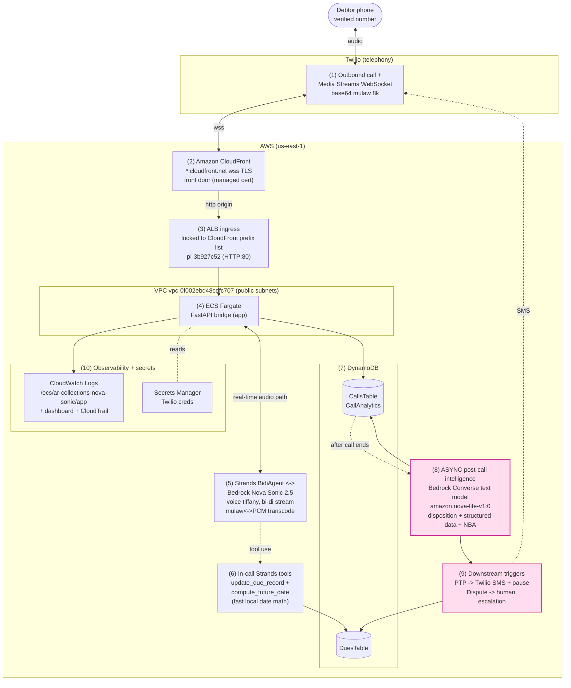

# AWS Architecture

AR Collections Nova Sonic 2.5 Agent: an AI-initiated outbound collections voice
agent. Twilio carries the audio, Amazon Bedrock Nova Sonic 2.5 is the
speech-to-speech brain (Strands bi-di), DynamoDB persists state, and the
intelligence (disposition + structured data + next-best-action) is extracted
**asynchronously after the call ends** so it never adds to call latency.

Live app: https://d3k3puelhq4ike.cloudfront.net/

The numbered labels (1..10) in the diagram map one-to-one to the phase
explanations below it.

## Phases

1. **Twilio outbound call.** Twilio places the AI-initiated outbound call (trial
   account, so only the verified number is reachable) and opens a Media Streams
   WebSocket carrying base64 G.711 mulaw, 8 kHz, mono.
2. **CloudFront TLS front door.** Amazon CloudFront (`*.cloudfront.net`,
   free managed cert) terminates viewer TLS at the edge so Twilio connects over
   `wss://`. Live: https://d3k3puelhq4ike.cloudfront.net/
3. **ALB ingress.** The Application Load Balancer accepts only CloudFront
   origin-facing edge IPs via managed prefix list `pl-3b927c52` on HTTP:80, so
   the raw ALB DNS is not directly reachable.
4. **ECS Fargate bridge.** The FastAPI app runs as a Fargate task in the public
   subnets of VPC `vpc-0f002ebd48cdfc707`, bridging the Twilio WebSocket to Nova.
5. **Strands BidiAgent + Nova Sonic 2.5.** Bi-directional streaming to Bedrock
   Nova Sonic 2.5 (voice `tiffany`) does STT + reasoning + TTS; the app
   transcodes mulaw 8k <-> PCM on the real-time audio path.
6. **In-call Strands tools.** `update_due_record` writes the outcome;
   `compute_future_date` is the code-interpreter date math (deterministic,
   local stdlib) that resolves phrases like "next month 1st Monday" on the turn
   without adding latency.
7. **DynamoDB persistence.** `DuesTable` holds due/account records and
   `CallsTable` holds the CallAnalytics record (numeric fields stored as
   `Decimal` via float->Decimal conversion).
8. **ASYNC post-call intelligence.** After the call ends and off the audio path,
   the Bedrock Converse text model `amazon.nova-lite-v1:0` extracts the Call
   Disposition, Structured Conversation Data, and the Next-Best-Action from the
   transcript.
9. **Downstream triggers.** Driven by the disposition: Promise to Pay (PTP)
   sends a Twilio SMS payment link and pauses automated collection; Dispute
   Raised escalates the account to a human specialist (flag/event).
10. **Observability + secrets.** CloudWatch Logs
    (`/ecs/ar-collections-nova-sonic/app`), the
    `ar-collections-nova-sonic-observability` dashboard, and a CloudTrail trail
    record activity; Twilio credentials live in Secrets Manager.

## Async / no-latency guarantee

Phases **8 and 9** (the code-interpreter resolution of relative dates, the LLM
structured extraction, and the downstream PTP/Dispute triggers) run
**asynchronously after the call has ended**, off the real-time audio/turn path,
as a fire-and-forget task. The call-latency metrics (`total_e2e_ms`,
`nova_total_ms`, `ttft_ms`) are computed on the audio path
(`session_start`..`session_end`) and are already frozen before this work runs,
so phases 8 and 9 **do not contribute to the call's end-to-end duration or
latency**.
